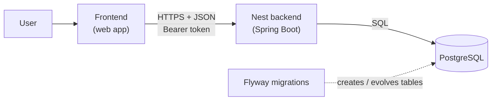
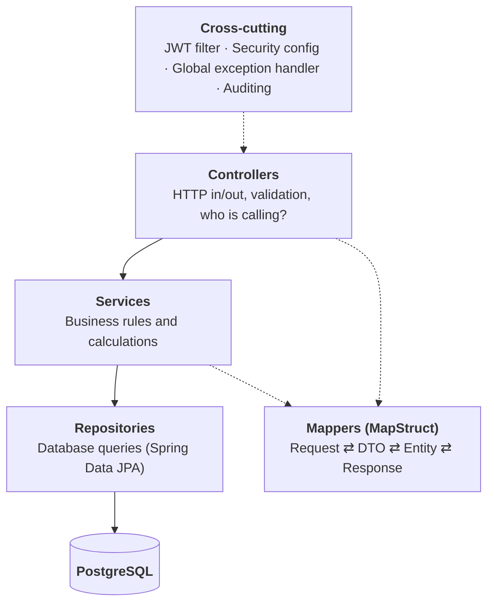
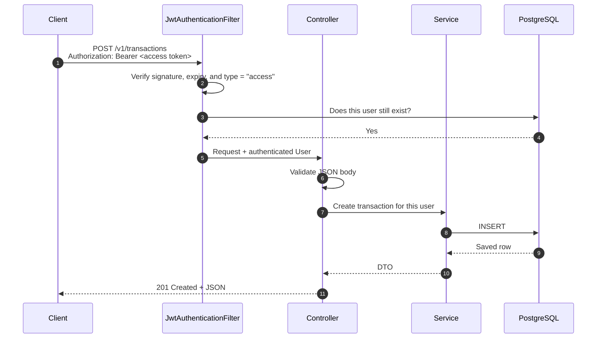
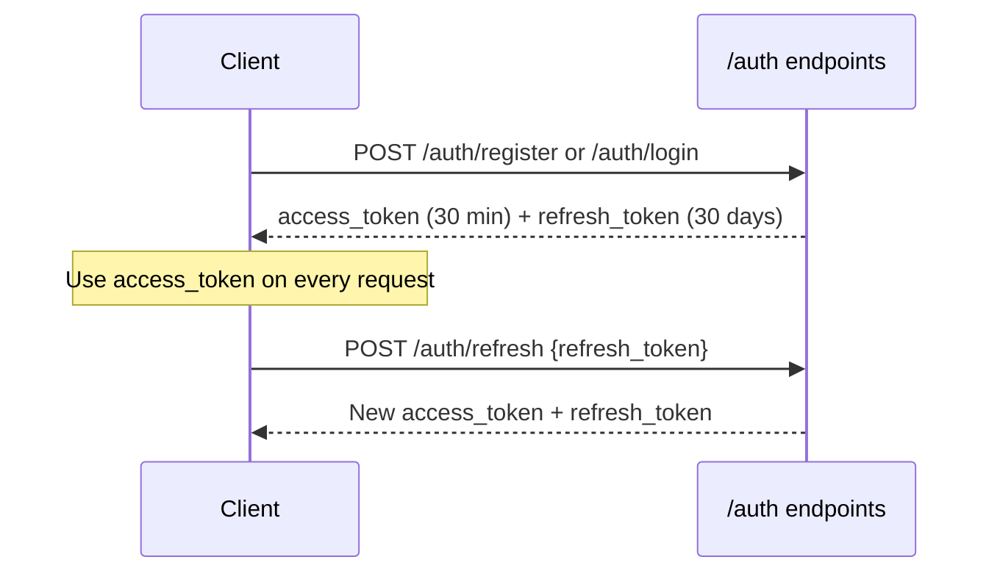
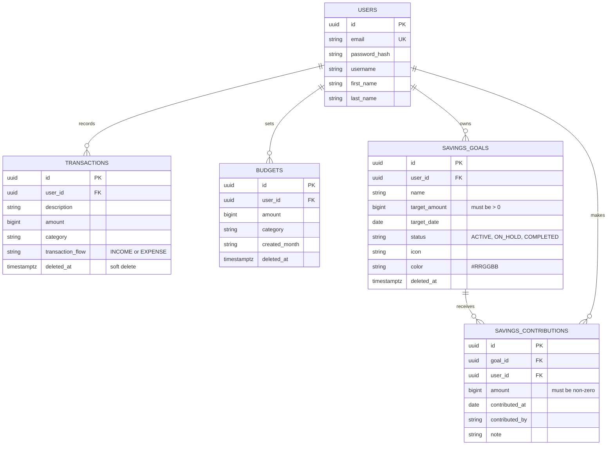

# Nest — Personal Budget Tracker (Backend)

> A secure REST API that helps one person answer three everyday money questions:
> **"Where is my money going?"**, **"Am I staying within my limits?"** and **"Am I on track to afford the things I'm saving for?"**

Built with **Java 27 + Spring Boot 4** and **PostgreSQL**.

---

## Table of Contents

1. [What is this project? (the plain-English version)](#1-what-is-this-project-the-plain-english-version)
2. [Features](#2-features)
3. [How it works at a glance](#3-how-it-works-at-a-glance)
4. [Tech stack](#4-tech-stack)
5. [Architecture](#5-architecture)
6. [Data model](#6-data-model)
7. [Design decisions: why, pros and cons](#7-design-decisions-why-pros-and-cons)
8. [API reference](#8-api-reference)
9. [Getting started](#9-getting-started)
10. [Project structure](#10-project-structure)
11. [Known limitations and roadmap](#11-known-limitations-and-roadmap)
12. [Glossary](#12-glossary)

---

## 1. What is this project? (the plain-English version)

Most of us have a vague sense of how much we spend, but not a clear picture. **Nest** is the engine behind a budgeting website that gives you that picture.

You can think of the app as a digital notebook with three sections:

| Section | The everyday question it answers | Real-life example |
|---|---|---|
| **Transactions** | "What came in and what went out?" | *RM 12 on lunch (Dining), RM 3,000 salary (Salary)* |
| **Budgets** | "How much am I *allowed* to spend on each thing this month?" | *"No more than RM 400 on Groceries in March."* |
| **Savings goals** | "How close am I to the thing I'm saving for?" | *"New laptop, RM 4,000 by December. I've saved RM 1,500. Am I on track?"* |

This repository contains **only the backend**. It exposes an **API** (a menu of requests that another program can make, such as "create a transaction" or "list my savings goals"). A web or mobile app talks to it over HTTP and exchanges JSON.

### What problem does it solve?

- Your financial data is **private**. Each user only ever sees their own records.
- Budget tracking needs **consistent rules** (no duplicate budgets, no negative amounts, goals that automatically flip to "completed"), and these rules must live in one trusted place rather than being re-implemented in every client.
- Progress questions like *"how much do I need to save per month to hit my goal?"* involve date maths that is easy to get wrong. The backend does this calculation once, correctly.

---

## 2. Features

**Accounts and security**
- Register, log in, and stay logged in using short-lived access tokens plus long-lived refresh tokens (JWT).
- Passwords are never stored. Only a salted BCrypt hash is kept.

**Transactions**
- Record income or expenses with a description, amount, and category (e.g. `GROCERIES`, `RENT`, `SALARY`).
- View a single transaction or the full list; delete (soft delete, so data is recoverable).

**Monthly budgets**
- Set a spending limit per category for the current month.
- Look up or adjust the limit for a given category and month.
- The system prevents creating two budgets for the same category in the same month.

**Savings goals**
- Create goals with a target amount, optional deadline, icon and colour.
- Add, edit and remove contributions toward a goal.
- Automatically calculated progress: amount saved, amount remaining, percent complete, **how much to save per month**, and whether you're **on track**.
- Status updates itself: reaching the target marks the goal `COMPLETED`, and removing a contribution that drops it below the target reverts it to `ACTIVE`.

---

## 3. How it works at a glance



A typical interaction, e.g. *"log a RM 12 lunch"*:

1. The user logs in and receives an **access token** (like a temporary wristband).
2. For every later request, the frontend shows that wristband in the `Authorization` header.
3. The backend verifies the wristband, works out *which user* it belongs to, validates the data, saves it, and replies with the saved record.

---

## 4. Tech stack

| Concern | Choice | Why it's here |
|---|---|---|
| Language / runtime | **Java 27** | Strong typing, mature ecosystem |
| Framework | **Spring Boot 4.1.2** (Web MVC) | Industry-standard way to build REST APIs |
| Database | **PostgreSQL** | Reliable relational database with strong data-integrity features |
| Data access | **Spring Data JPA / Hibernate** | Maps Java objects to tables, reducing boilerplate SQL |
| Schema management | **Flyway** | Version-controlled, repeatable database changes |
| Security | **Spring Security + OAuth2 JOSE (Nimbus)** | Stateless JWT authentication, BCrypt password hashing |
| Validation | **Jakarta Bean Validation** | Declarative input checks (`@NotBlank`, `@Positive`, `@Future`, ...) |
| Object mapping | **MapStruct** | Compile-time generated converters between layers (no reflection at runtime) |
| Boilerplate removal | **Lombok** | Generates getters, setters and constructors |
| Code style | **Spotless + google-java-format** | Enforced consistent formatting during the build |
| Build | **Maven (wrapper included)** | `./mvnw` means no separate Maven install |

---

## 5. Architecture

### 5.1 Layered design

The code follows a classic **layered architecture**. Each layer has one job and only talks to the layer directly beneath it.



| Layer | Package | Responsibility | Analogy |
|---|---|---|---|
| **Controllers** | `controllers` | Receives HTTP requests, validates input, identifies the logged-in user, returns responses | The waiter: takes your order, brings the food |
| **Services** | `services` / `services.impl` | Business rules: duplicate checks, progress maths, status transitions | The kitchen: where the real work happens |
| **Repositories** | `repositories` | Reads and writes the database | The pantry: fetches and stores ingredients |
| **Models (entities)** | `models` | Java classes that mirror database tables | The pantry's shelf labels |
| **DTOs** | `dtos`, `controllers/dtos` | Plain data carriers for moving information between layers | The order slips passed between waiter and kitchen |
| **Mappers** | `mappers` | Convert between entities, DTOs and API payloads | Translators |
| **Security** | `security`, `configs` | JWT creation and verification, route protection | The doorman checking wristbands |
| **Exceptions / handlers** | `exceptions`, `handlers` | Turn errors into clean, consistent HTTP responses | A polite "sorry, here's what went wrong" |

### 5.2 Three kinds of "data object", and why

Data takes a different shape at each stage of its journey:

```
HTTP JSON ──► Request DTO ──► Service DTO ──► Entity ──► Database row
(outside)   (validated input)  (internal)    (persistence)

Database row ──► Entity ──► Service DTO ──► Response DTO ──► HTTP JSON
```

This keeps the *public API shape* independent from the *database shape*. For example, the API never exposes a user's password hash, and the database can change without breaking clients.

### 5.3 Request lifecycle (authentication)



Key points:

- Routes under `/auth/**` are public (register, login, refresh). **Everything else requires a valid access token.**
- The server keeps **no session**. All the identity information is in the token (this is called *stateless* authentication).
- Controllers receive the logged-in `User` directly, and every query is **scoped by that user's id**, so one user can never read another user's data.

### 5.4 Authentication flow



- **Access token** — lives 30 minutes. If it leaks, the damage window is small.
- **Refresh token** — lives 30 days. It can only be used at `/auth/refresh`; using it as an access token is rejected (the token carries a `type` claim that is checked).

### 5.5 Error handling

A single `GlobalExceptionHandler` converts exceptions into a consistent JSON body, `{"message": "..."}`:

| Situation | HTTP status |
|---|---|
| Invalid or malformed input | `400 Bad Request` |
| Missing, invalid or expired token; wrong credentials | `401 Unauthorized` |
| Record doesn't exist (or isn't yours) | `404 Not Found` |
| Action conflicts with existing data (e.g. email already registered, duplicate budget) | `409 Conflict` |

---

## 6. Data model



All tables also carry `created_at` / `updated_at`, filled automatically by JPA auditing.

**Categories** (a fixed list): `BILLS, DINING, EDUCATION, ENTERTAINMENT, FOOD, FREELANCE, GROCERIES, HEALTH, INVESTMENTS, RENT, SALARY, SHOPPING, TRANSPORT, TRAVEL, UTILITIES, OTHERS`

**Schema history** (managed by Flyway in `src/main/resources/db/migration`):

| Version | What it does |
|---|---|
| `V1__init_schema.sql` | Creates all five tables, foreign keys, indexes and check constraints |
| `V2__update_timestamp_to_timestampz.sql` | Upgrades timestamps to timezone-aware (`TIMESTAMPTZ`), interpreting existing values as Malaysia time |

---

## 7. Design decisions: why, pros and cons

Every design choice is a trade-off. This section is honest about both sides.

### 7.1 Layered architecture (Controller → Service → Repository)

**Why:** It separates *what the API looks like*, *what the rules are*, and *how data is stored*.

| Pros | Cons |
|---|---|
| Easy to navigate: you always know where to look | More files and classes for a small app |
| Business rules are testable without HTTP or a database | Simple actions pass through several layers (some boilerplate) |
| A layer can change without rewriting the others | |

### 7.2 DTOs + MapStruct instead of exposing entities directly

**Why:** The API shape shouldn't be tied to the database shape.

| Pros | Cons |
|---|---|
| Sensitive fields (e.g. `password_hash`) can never leak by accident | Many small classes (request, DTO, response) per feature |
| The database can evolve without breaking clients | Mapper mismatches surface at compile time or as subtle `null`s, so they need attention |
| MapStruct generates plain Java at compile time (fast, no reflection, debuggable) | Adds annotation-processor configuration (Lombok + MapStruct binding) |

### 7.3 Stateless JWT authentication (access + refresh tokens)

**Why:** Scales simply and suits a separate frontend or a future mobile app.

| Pros | Cons |
|---|---|
| No server-side session storage; any instance can verify any token | Tokens can't be revoked individually before they expire |
| Short access-token lifetime limits the blast radius of a leak | Refresh tokens are not stored, so "log out everywhere" isn't possible yet |
| Token `type` claim stops a refresh token being misused as an access token | Symmetric signing (HS256) means the same secret signs *and* verifies; it must be guarded carefully |

### 7.4 Money stored as whole numbers (`BIGINT`)

**Why:** Floating-point numbers cannot represent values like 0.10 exactly, which causes drifting totals. Integers are exact.

| Pros | Cons |
|---|---|
| No rounding errors in sums and comparisons | The client must agree on the unit (e.g. store the smallest currency unit) and format for display |
| Fast, simple SQL aggregation | Only one currency is implied; multi-currency would need a currency column |

### 7.5 Soft deletes (`deleted_at`)

**Why:** Financial history is valuable; accidental deletion should be recoverable.

| Pros | Cons |
|---|---|
| Data can be restored or audited | Every query must remember `... AND deleted_at IS NULL` |
| Keeps history consistent for reports | Table grows over time; needs an occasional purge strategy |

*Used for transactions, budgets (column present) and savings goals. Contributions are deleted permanently.*

### 7.6 Savings progress is calculated on demand, not stored

**Why:** `current_amount`, `percent_complete`, `monthly_needed` and `on_track` are derived from contributions and today's date. Storing them would risk them going out of sync.

| Pros | Cons |
|---|---|
| Single source of truth: the contributions themselves | A SUM query runs on reads |
| Never stale, even when contributions are edited or deleted | Mitigated for lists: one grouped query covers all goals, avoiding an "N+1" query pattern |

**How "on track" is decided:** you are on track if the **fraction of the target saved** is at least the **fraction of time elapsed** between the goal's creation date and its deadline. **Monthly needed** is `ceil(remaining ÷ months left)`, with a minimum of one month.

### 7.7 Flyway migrations + Hibernate `ddl-auto: validate`

**Why:** The database schema is changed deliberately through versioned SQL files. Hibernate only *checks* that the code matches the schema and never alters it.

| Pros | Cons |
|---|---|
| Reproducible, reviewable schema history (like Git for your database) | Every schema change needs a hand-written migration |
| Production data is never accidentally modified by the ORM | Entity and migration must be kept in step manually |

### 7.8 UUID v7 primary keys

**Why:** UUIDs can be generated without asking the database, are hard to guess (unlike `1, 2, 3...`), and v7 is **time-ordered**, which keeps database indexes efficient.

| Pros | Cons |
|---|---|
| Non-guessable IDs, safe to expose in URLs | Larger than integer keys (16 bytes vs 4/8) |
| Roughly sortable by creation time | Less human-friendly when debugging |

### 7.9 Strict JSON handling (`snake_case`, unknown fields rejected)

**Why:** The API speaks `snake_case` JSON (`target_amount`) and rejects fields it doesn't recognise, so typos fail loudly instead of being silently ignored.

| Pros | Cons |
|---|---|
| Catches client mistakes early | Clients must send exactly what the API expects |
| One consistent naming convention across the API | Adding fields later requires a coordinated client update |

### 7.10 Fixed timezone (`Asia/Kuala_Lumpur`)

**Why:** "This month" and "today" must mean the same thing for the user regardless of where the server runs.

| Pros | Cons |
|---|---|
| Month boundaries and deadlines behave predictably | Hard-coded: users in other timezones would see off-by-hours boundaries |

---

## 8. API reference

- **Base URL (local):** `http://localhost:8080/v1`
- **Format:** JSON, with `snake_case` field names
- **Auth:** send `Authorization: Bearer <access_token>` on every endpoint except `/auth/**`

### Authentication

| Method | Path | Purpose | Body |
|---|---|---|---|
| `POST` | `/auth/register` | Create an account and get tokens | `email`, `password` (8–72 chars), `username` (3–50), `first_name`, `last_name` |
| `POST` | `/auth/login` | Log in and get tokens | `email`, `password` |
| `POST` | `/auth/refresh` | Exchange a refresh token for new tokens | `refresh_token` |

Response: `{ "access_token": "...", "refresh_token": "...", "token_type": "bearer" }`

### User

| Method | Path | Purpose |
|---|---|---|
| `GET` | `/user-info` | Profile of the logged-in user |

### Transactions

| Method | Path | Purpose |
|---|---|---|
| `POST` | `/transactions` | Create a transaction (`201`) |
| `GET` | `/transactions` | List your transactions |
| `GET` | `/transactions/{id}` | Get one transaction |
| `DELETE` | `/transactions/{id}` | Soft-delete (`204`) |

### Budgets

| Method | Path | Purpose |
|---|---|---|
| `POST` | `/budgets` | Create a budget for the **current month** (`category`, `amount`)(`201`); `409` if one already exists |
| `GET` | `/budgets?category=FOOD&month=MARCH` | Fetch a budget |
| `PATCH` | `/budgets?category=FOOD&month=MARCH` | Change the amount (`amount`) |

### Savings goals

| Method | Path | Purpose |
|---|---|---|
| `POST` | `/savings` | Create a goal (`201`) |
| `GET` | `/savings` | List goals, newest first, with progress |
| `GET` | `/savings/{id}` | One goal with progress |
| `PUT` | `/savings/{id}` | Edit a goal (including `status`) |
| `DELETE` | `/savings/{id}` | Soft-delete a goal |
| `POST` | `/savings/{id}/contributions` | Add a contribution (`201`); returns the contribution and the updated goal |
| `GET` | `/savings/{id}/contributions` | List contributions, newest first |
| `PUT` | `/savings/{id}/contributions/{contributionId}` | Edit a contribution |
| `DELETE` | `/savings/{id}/contributions/{contributionId}` | Remove a contribution; returns the updated goal |

**Example: create a savings goal**

```http
POST /v1/savings
Authorization: Bearer <access_token>
Content-Type: application/json

{
  "name": "New laptop",
  "target_amount": 400000,
  "target_date": "2027-06-30",
  "icon": "laptop",
  "color": "#3366FF"
}
```

```json
{
  "id": "0198…",
  "name": "New laptop",
  "target_amount": 400000,
  "current_amount": 0,
  "remaining_amount": 400000,
  "percent_complete": 0.0,
  "target_date": "2027-06-30",
  "monthly_needed": 36364,
  "on_track": true,
  "status": "ACTIVE",
  "icon": "laptop",
  "color": "#3366FF"
}
```

*(Amounts are whole numbers; here the client treats them as the smallest currency unit. `target_date` must be a future date; `color` must be `#RRGGBB`.)*

---

## 9. Getting started

### Prerequisites

- **JDK 27** (as configured in `pom.xml`)
- **PostgreSQL** reachable at `localhost:5433` with a database named `budget-app-springboot`
- No separate Maven needed; use the included wrapper (`./mvnw`, or `mvnw.cmd` on Windows)

### 1. Start a database

Using Docker is the quickest route:

```bash
docker run --name nest-db \
  -e POSTGRES_PASSWORD=postgres \
  -e POSTGRES_DB=budget-app-springboot \
  -p 5433:5432 -d postgres
```

### 2. Set the JWT secret

The app **refuses to start without it**. Use a long random value (at least 32 characters for HS256):

```bash
# macOS / Linux
export JWT_SECRET="$(openssl rand -base64 48)"

# Windows PowerShell
$env:JWT_SECRET = "replace-with-a-long-random-secret-value"
```

### 3. Run

```bash
./mvnw spring-boot:run
```

Flyway creates the tables on first start. The API is now live at `http://localhost:8080/v1`.

### 4. Try it

```bash
# Register
curl -X POST http://localhost:8080/v1/auth/register \
  -H "Content-Type: application/json" \
  -d '{"email":"me@example.com","password":"correct-horse-battery","username":"me","first_name":"Ada","last_name":"Lovelace"}'

# Use the returned access_token
curl http://localhost:8080/v1/user-info -H "Authorization: Bearer <access_token>"
```

### Configuration

Defaults live in `src/main/resources/application.yaml`:

| Setting | Default | Notes |
|---|---|---|
| `server.port` | `8080` | |
| `server.servlet.context-path` | `/v1` | All routes are prefixed with this |
| `spring.datasource.url` | `jdbc:postgresql://localhost:5433/budget-app-springboot` | |
| `spring.datasource.username` / `password` | `postgres` / `postgres` | **Local-development defaults only**; override via environment variables for any shared environment |
| `jwt.secret` | `${JWT_SECRET}` | Required; no default |
| `jwt.algorithm` | `HS256` | |

Spring Boot lets you override any of these with environment variables (e.g. `SPRING_DATASOURCE_URL`, `SPRING_DATASOURCE_PASSWORD`).

### Tests and formatting

```bash
./mvnw test       # runs with the "test" profile; needs the database reachable
./mvnw spotless:apply   # auto-format code (the build fails on badly formatted code)
```

---

## 10. Project structure

```
src/main/java/nest/com/budget_app/
├── BudgetAppApplication.java      # entry point
├── configs/                       # Security, JWT beans, JPA auditing
├── security/                      # JwtAuthenticationFilter
├── controllers/                   # REST endpoints
│   └── dtos/{requests,responses}  # API-facing payloads
├── services/ (+ impl/)            # business logic (interface + implementation)
├── repositories/                  # Spring Data JPA queries
├── models/                        # JPA entities (BaseEntity adds created/updated timestamps)
├── dtos/                          # internal data-transfer objects
├── mappers/                       # MapStruct converters
├── enums/                         # Category, TransactionFlow, SavingGoalStatus, TokenType, ...
├── exceptions/ + handlers/        # custom errors and the global error handler
└── utils/                         # DateUtil (timezone), PasswordUtil (BCrypt), UuidUtil

src/main/resources/
├── application.yaml
└── db/migration/                  # Flyway SQL migrations (V1, V2)
```

---

## 11. Known limitations and roadmap

This project is actively evolving. Being upfront about the rough edges:

**Known issues to fix**
- The savings **contribution** endpoints reuse the *goal* request body (`name`, `target_amount`, ...), so a contribution's `amount` and `note` aren't captured from the request. These endpoints need a dedicated request class.
- `SavingsContributionRepository.findByIdAndGoal_IdAndDeletedAtIsNull` refers to a `deletedAt` field, but the `SavingsContribution` entity and table have none. Contributions are hard-deleted, so the query should drop that condition (or a column should be added).

**Functional gaps**
- **Budgets** store the month but not the year, so "March" is ambiguous across years; there is also no delete/list endpoint, and no database-level uniqueness on (user, category, month). Budgets can currently only be created for the *current* month.
- **Transactions** have no update endpoint, pagination, or date/category filtering.
- **Analytics** (total income/expense, spending by category, net cash flow, savings rate) already exist in the service layer but aren't exposed through an endpoint yet. Budget-vs-actual comparison is the natural next feature.
- The `ON_HOLD` goal status exists, but nothing enforces special behaviour for it yet.

**Security and operations**
- Refresh tokens can't be revoked or rotated server-side.
- No rate limiting on login.
- Local database credentials sit in `application.yaml`; move them to environment variables or a secrets manager for real deployments.
- Test coverage is currently a single context-loads smoke test. Service-level unit tests (especially for the savings progress maths) and API integration tests are the highest-value additions.

**Ideas**
- Multi-currency support, recurring transactions, CSV import/export, per-user timezone, OpenAPI/Swagger documentation, Docker Compose for one-command startup.

---

## 12. Glossary

| Term | Meaning |
|---|---|
| **API** | A defined set of requests a program can make to another program |
| **REST** | A common API style using URLs and HTTP verbs (`GET`, `POST`, `PUT`, `DELETE`) |
| **JSON** | A lightweight text format for structured data, e.g. `{"amount": 500}` |
| **JWT** | *JSON Web Token*: a signed string proving who you are, without the server keeping a session |
| **Access / refresh token** | A short-lived pass for requests / a long-lived pass used only to get a new short-lived one |
| **BCrypt** | A deliberately slow password-hashing algorithm that makes stolen password databases hard to crack |
| **Entity** | A Java class that represents a database table row |
| **DTO** | *Data Transfer Object*: a simple container for moving data between layers |
| **Migration** | A versioned script that changes the database structure |
| **Soft delete** | Marking a record as deleted (with a timestamp) instead of erasing it |
| **Stateless** | The server remembers nothing between requests; each request carries all it needs |
| **N+1 query problem** | A performance trap where one query for a list triggers an extra query per item |
